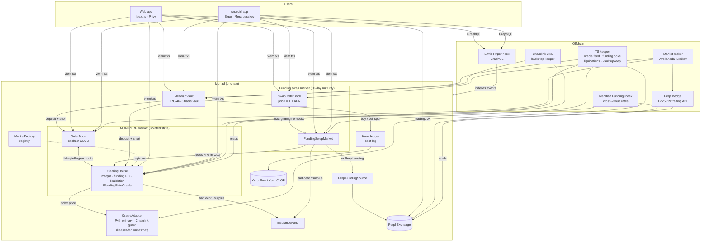

# Meridian


**The funding-rate layer for Monad.** Meridian is a perpetual exchange where funding accrues every block. Its funding rate is also a public onchain oracle that other contracts can read, earn from, or lock in at a fixed rate.

> **Trade it** with a per-block-funding perp · **Read it** through a public funding-rate oracle · **Earn it** in a delta-neutral basis vault · **Fix it** with fixed-for-floating funding swaps

<p>
  <a href="https://meridian-testnet.vercel.app/"><b>Launch the app →</b></a> &nbsp;·&nbsp;
  <a href="docs/outputs/TESTNET_GUIDE.md">Testnet guide</a> &nbsp;·&nbsp;
  <a href="docs/outputs/PROOF.md">Proof of every claim</a> &nbsp;·&nbsp;
  <a href="docs/outputs/BENCHMARKS.md">Benchmarks</a> &nbsp;·&nbsp;
  <a href="docs/outputs/WRITEUP.md">Write-up</a>
</p>

| | |
|---|---|
| **Live app** | **https://meridian-testnet.vercel.app/** (Monad testnet, chain id `10143`) |
| **Network** | Monad testnet · RPC `https://testnet-rpc.monad.xyz` · explorer [testnet.monadscan.com](https://testnet.monadscan.com) · gas from [faucet.monad.xyz](https://faucet.monad.xyz) |
| **Collateral** | USDC, 6 decimals. Testnet uses the mock `tUSDC`, mintable from the in-app faucet |
| **Markets** | `MON-PERP` (perp, up to 5x) and `MON-FUNDING-PERPL` (30-day funding swap that settles on Perpl's MON funding) |
| **Status** | Live on testnet. Mainnet (143) is ready by rehearsal and not deployed yet (see [Status](#status)) |
| **Licence** | [MIT](LICENSE) |

---

## Contents

1. [Why Meridian](#why-meridian)
2. [Product](#product)
3. [Architecture](#architecture)
4. [Smart contracts](#smart-contracts)
5. [Deployed contracts (Monad testnet)](#deployed-contracts-monad-testnet)
6. [Funding, risk and vault parameters](#funding-risk-and-vault-parameters)
7. [Offchain services](#offchain-services)
8. [Apps: web and mobile](#apps-web-and-mobile)
9. [Integrations](#integrations)
10. [Security and testing](#security-and-testing)
11. [Performance on Monad](#performance-on-monad)
12. [Repository layout](#repository-layout)
13. [Getting started](#getting-started)
14. [Status](#status)
15. [Documentation](#documentation)
16. [Team, licence and history](#team-licence-and-history)

---

## Why Meridian

Most perp venues settle funding every 1 to 8 hours. That schedule dates from slower chains and exchanges, not from anything the product needs. Discrete funding creates jumps at each settlement, gives traders reasons to game the timestamp, and keeps the rate locked inside each venue.

Monad produces a block about every **300 ms** and finalises in about 600 ms. That makes three things practical:

1. **Funding every block.** Every position accrues funding continuously through two O(1) cumulative indices, with no settlement cliff.
2. **The funding rate as a public good.** The rate is written onchain once per block, so any contract can read the average rate over any window in constant gas.
3. **Products built on the rate.** Once the rate is a readable primitive, you can earn it (basis vault) and swap it for a fixed rate (funding swaps), on Meridian's own funding or on another venue's, such as Perpl's.

No other Monad perp offers per-block funding, a funding oracle, a basis vault or fixed-rate funding (research in [`docs/ARCHITECTURE.md`](docs/ARCHITECTURE.md) §0, R27–R28).

---

## Product

### 1. Trade it: MON-PERP with per-block funding

- A **fully onchain central limit order book**: price-time priority, a two-level tick bitmap, and limit, market, post-only and reduce-only orders.
- **Isolated margin** up to **5x** (20% initial margin, 10% maintenance margin).
- **Funding every block.** A premium EMA of the book's fair price against the oracle index, plus an interest component. Both the per-block change and the absolute rate are capped. Positions settle lazily in O(1): `owed = q · (F_now − F_entry)`.
- A **median mark price** that bounds manipulation, permissionless **liquidations**, an **insurance fund** and a **bad-debt waterfall**: insurance fund first, then protocol fees, then recorded as uncovered.
- **Stale-oracle protection.** When the index is stale, funding freezes and the market only accepts trades that reduce risk. Resting maker orders are skipped, not cancelled.

### 2. Read it: the public funding-rate oracle

`ClearingHouse` implements `IFundingRateOracle`. Next to the funding index **F** it keeps a notional-time index **G**. The average funding rate over any window is

```
avgRate(t0, t1) = (F(t1) − F(t0)) / (G(t1) − G(t0))
```

Checkpoints are written into a 1,440-slot ring buffer, one every 200 blocks, so time-weighted average rates (TWARs) are a single view call with no loops and no extra transactions.

### 3. Earn it: the basis vault

`MeridianVault` is an **ERC-4626** vault with an asynchronous withdrawal queue. It holds spot MON plus a matching short MON-PERP position, so it collects positive funding while staying delta-neutral. A keeper calls the rule-based `rebalance()`, which sizes the short against the net long skew of the book. It deploys, trims drift, tops up margin, or exits the hedge, all under slippage caps. NAV is marked at the oracle index, not at a venue mid. Withdrawals are served from idle funds or by unwinding a bounded pro-rata slice of both legs.

### 4. Fix it: funding swaps

`FundingSwapMarket` lists **30-day fixed-for-floating funding swaps** on Meridian's own order-book engine. The price is quoted as `1 + APR`, and one tick is 1 bp of APR. A position settles `net = q·ΔF − K·ΔG / YEAR` against the floating leg. The floating leg can be Meridian's own funding, or **Perpl's** MON-perp funding read onchain through `PerplFundingSource` (the live testnet market is `MON-FUNDING-PERPL`, see [`docs/PERPL_SWAPS.md`](docs/PERPL_SWAPS.md)). At maturity anyone can call `settleMaturity()`, which snapshots F and G.

---

## Architecture

### System overview



### Design principles

| Principle | How it shows up |
|---|---|
| **One engine, many markets** | The same `OrderBook` drives the perp and every swap market through a single `IMarginEngine` protocol (`reserveOrderMargin`, `settleMakerFill`, `settleTakerFill`). |
| **Isolated state per market** | Each market has its own `OrderBook` and `ClearingHouse`/`FundingSwapMarket`, so trades in different markets never touch shared storage and run in parallel on Monad. |
| **Funding written once per block** | The first transaction in a block that touches a market writes the packed funding state (`_touchFunding`). Every later transaction in that block only reads it. |
| **Trades don't move tokens** | Collateral is internal accounting. Fills don't write ERC-20 balances, which removes a whole class of parallel-execution conflicts. |
| **MIP-8-aware storage** | Order slots are recycled from a free list instead of being deleted. Adjacent ticks map to adjacent slots, and the hot header and level slots share one 4 KB page. |
| **Non-upgradeable** | No proxies. Parameters can change only within bounds hard-coded in the setters. Migration means deploying v2 markets and setting v1 to reduce-only. |
| **Round against the user** | All money math is WAD fixed-point with an explicit rounding direction for every operation ([`docs/MATH_SPEC.md`](docs/MATH_SPEC.md)). |

### Key call flows

<details>
<summary><b>Order placement and matching</b></summary>

1. `OrderBook.placeLimitOrder(isBid, tick, lots, flags)` validates the tick and lot size, the open-order limit (64) and the post-only rule.
2. Crossing size matches against resting liquidity, with at most 32 fills per order. Each maker fill calls `ClearingHouse.settleMakerFill`, which touches funding, updates the position and charges the fee. If a maker can no longer cover its order, the order is evicted lazily.
3. The taker's initial margin is checked once at the end in `settleTakerFill`. If that check fails, the whole transaction reverts.
4. Any remainder rests: `reserveOrderMargin`, then it is appended to the level FIFO and the bitmap bit is set.
</details>

<details>
<summary><b>Funding update (first touch per block)</b></summary>

```
premium = clamp((fairBookPrice − index) / index, ±5%)
p̄       = αeff · premium + (1 − αeff) · p̄_prev      // αeff = 1 − (1 − α)^n over n blocks
r       = clamp(p̄ / 1h + interest, r_prev ± δ·n)     // per-block change cap
r       = clamp(r, ±cap)                             // absolute cap, applied last
F      += r · index · Δt                              // Δt = n · 300 ms (block-number time base)
G      += index · Δt
```

Time comes from block numbers, not `block.timestamp`, because Monad timestamps have one-second resolution and about three blocks share each one.
</details>

<details>
<summary><b>Liquidation</b></summary>

A keeper (TS or Chainlink CRE) finds accounts below maintenance margin, using indexer positions and the mark price. It calls `ClearingHouse.liquidate(account, maxSize)`. The position moves to the liquidator at the mark price, and the liquidator must pass the initial-margin check afterwards. The penalty is split between the keeper and the insurance fund. Any negative collateral goes through the waterfall: insurance fund, then fees, then `totalBadDebt`.
</details>

<details>
<summary><b>Vault rebalance</b></summary>

`needsRebalance()` returns one of four actions. **Deploy**: buy spot through `KuruHedger`, deposit margin, open a short. **DeltaDrift**: trim the larger leg. **MarginLow**: sell some spot to top up margin. **ExitHedge**: close the short, sell the spot and return everything to idle. The keeper can call only this rule-based function, and only within the slippage caps.
</details>

Full design notes: [`docs/ARCHITECTURE.md`](docs/ARCHITECTURE.md). Normative math: [`docs/MATH_SPEC.md`](docs/MATH_SPEC.md). Generated interfaces: [`docs/INTERFACES.md`](docs/INTERFACES.md).

---

## Smart contracts

Foundry, Solidity, Cancun EVM. Source in [`contracts/src`](contracts/src), ABIs exported to [`abis/`](abis).

| Contract | Path | Role |
|---|---|---|
| `OrderBook` | `orderbook/OrderBook.sol` + `libraries/TickBitmap.sol` | Generic onchain CLOB, one instance per market; calls back into its margin engine |
| `ClearingHouse` | `clearing/ClearingHouse.sol` | Perp margin engine: collateral, positions, per-block funding (F, G), mark, liquidation, fees; implements `IFundingRateOracle` |
| `InsuranceFund` | `clearing/InsuranceFund.sol` | Shared backstop for authorised markets; covers bad debt, receives penalties and surplus |
| `MarketFactory` | `clearing/MarketFactory.sol` | Registry of markets (never read on the hot path) |
| `FundingLib`, `MarkPriceLib`, `MarginLib` | `libs/` | Funding update, median mark, margin and equity math |
| `SwapMathLib`, `SwapMarginLib` | `libs/` | Fixed-for-floating accrual and swap margin |
| `PythChainlinkOracleAdapter` | `oracle/` | Mainnet index: Pyth primary with a staleness check and a Chainlink deviation guard |
| `TestnetKeeperOracle` | `oracle/` | Testnet index, pushed by allow-listed feeders from mainnet Pyth MON/USD |
| `PerplFundingSource` | `oracle/` | Reads Perpl's onchain funding and exposes it as F/G indices for swaps |
| `MeridianMfiFeed` | `oracle/` | Onchain Meridian Funding Index, written by the CRE workflow |
| `FundingSwapMarket` | `swaps/` | 30-day fixed-for-floating funding swaps, matched on its own `OrderBook` |
| `MeridianVault` | `vault/` | ERC-4626 basis vault with an async withdrawal queue |
| `KuruHedger` | `vault/` | Executes the vault's spot leg through Kuru Flow routes, with output enforced by balance delta |
| `MeridianKeeperReceiver` | `automation/` | Chainlink CRE `onReport` consumer: funding pokes, liquidations, vault upkeep |

---

## Deployed contracts (Monad testnet)

Chain id **10143**. Redeployed on **4 Nov 2026** with USDC collateral, start block **76,880,663**. The source of truth is [`deployments/10143.json`](deployments/10143.json). Every reader in the repo (`@meridian/core`, app, mobile, bots, indexer) loads addresses from that file, so never copy them by hand.

### Core protocol: MON-PERP

| Contract | Address |
|---|---|
| ClearingHouse | [`0x59C71095dc92441b792be52C5a3578C6C61913CE`](https://testnet.monadscan.com/address/0x59C71095dc92441b792be52C5a3578C6C61913CE) |
| OrderBook | [`0x2d8eb2cD64ecBF9bFb5CE0F4Eb6C9f2a9de6750b`](https://testnet.monadscan.com/address/0x2d8eb2cD64ecBF9bFb5CE0F4Eb6C9f2a9de6750b) |
| OracleAdapter (keeper-fed) | [`0x23a16055506ecFf0c1533fE85768eA9068e4aA68`](https://testnet.monadscan.com/address/0x23a16055506ecFf0c1533fE85768eA9068e4aA68) |
| InsuranceFund | [`0x9f2D50c9dcefd015F9b40FbC3ABe31d2Cfe3941b`](https://testnet.monadscan.com/address/0x9f2D50c9dcefd015F9b40FbC3ABe31d2Cfe3941b) |
| MarketFactory | [`0x9277E09F143e654Eb9A12378f715813da2c40501`](https://testnet.monadscan.com/address/0x9277E09F143e654Eb9A12378f715813da2c40501) |
| MeridianVault | [`0xAC2E530E5db8056bFf7D5C47E453dB88087d4f80`](https://testnet.monadscan.com/address/0xAC2E530E5db8056bFf7D5C47E453dB88087d4f80) |
| KuruHedger (mock on testnet) | [`0x6CCE3e1Ac202576257bB5F21C4fdd6593BAC9EbD`](https://testnet.monadscan.com/address/0x6CCE3e1Ac202576257bB5F21C4fdd6593BAC9EbD) |
| FundingSwapMarket (Meridian funding) | [`0xfcc42f31b6Fe04b0FE082112a726f45Cc1035E5A`](https://testnet.monadscan.com/address/0xfcc42f31b6Fe04b0FE082112a726f45Cc1035E5A) |
| SwapOrderBook (Meridian funding) | [`0x5477689ef84F1880d2748A732EE029C43698D7EE`](https://testnet.monadscan.com/address/0x5477689ef84F1880d2748A732EE029C43698D7EE) |

### Perpl-funding swap market: MON-FUNDING-PERPL

Start block 76,896,989 · lot 1,000 MON · tick 1 bp APR · Perpl perp id 64 · maturity `1796381644`.

| Contract | Address |
|---|---|
| FundingSwapMarket | [`0x7fd19921030aF2DDEb6478e0611BCC434Af12498`](https://testnet.monadscan.com/address/0x7fd19921030aF2DDEb6478e0611BCC434Af12498) |
| SwapOrderBook | [`0xcD5DADfd92C500F0c6BFb2Cc40400086550fB2A2`](https://testnet.monadscan.com/address/0xcD5DADfd92C500F0c6BFb2Cc40400086550fB2A2) |
| PerplFundingSource | [`0xF40B96d21F137697C1Db9B6b4E4bDe84856cE2df`](https://testnet.monadscan.com/address/0xF40B96d21F137697C1Db9B6b4E4bDe84856cE2df) |
| Perpl Exchange (Perpl's contract) | [`0x1964C32f0bE608E7D29302AFF5E61268E72080cc`](https://testnet.monadscan.com/address/0x1964C32f0bE608E7D29302AFF5E61268E72080cc) |

### Demo market: MON-PERP-DEMO

A test market with a keeper-fed oracle, used **only** for the crash and liquidation demo. Real Pyth prices can't be moved on demand, and the main market's price is never forced.

| Contract | Address |
|---|---|
| ClearingHouse | [`0x68a95469e72ed55Bf47c882811A5343b9A69eAEb`](https://testnet.monadscan.com/address/0x68a95469e72ed55Bf47c882811A5343b9A69eAEb) |
| OrderBook | [`0xbc01B2F0130d26D74103235afb2bf3Ee3cf4A4C1`](https://testnet.monadscan.com/address/0xbc01B2F0130d26D74103235afb2bf3Ee3cf4A4C1) |
| OracleAdapter | [`0xd5DbD1C624CBc08DF9c8B69B65cddf8fe0eBD1c4`](https://testnet.monadscan.com/address/0xd5DbD1C624CBc08DF9c8B69B65cddf8fe0eBD1c4) |

### Tokens and operators

| | Address |
|---|---|
| USDC (testnet mock `tUSDC`, 6 dp, open `mint`) | [`0xCE10D23dbE5054fF7311c4FB3703C9CF740e9251`](https://testnet.monadscan.com/address/0xCE10D23dbE5054fF7311c4FB3703C9CF740e9251) |
| WMON | [`0xFb8bf4c1CC7a94c73D209a149eA2AbEa852BC541`](https://testnet.monadscan.com/address/0xFb8bf4c1CC7a94c73D209a149eA2AbEa852BC541) |
| Owner (testnet deployer) | [`0x4844Ce488a1B2428f9E375c5659C5D7C4903313c`](https://testnet.monadscan.com/address/0x4844Ce488a1B2428f9E375c5659C5D7C4903313c) |
| Keeper and oracle feeder | [`0xB99DB60ED7c130B098B5B329d1c9BDEd5db81B93`](https://testnet.monadscan.com/address/0xB99DB60ED7c130B098B5B329d1c9BDEd5db81B93) |
| Market makers and house flow | `0xB70B…214c`, `0x28FB…238a`, `0x86dE…75D5` (full addresses in the record) |

> The deployment before 4 Nov (AUSD collateral, plus an ETH-PERP market) is retired. Its record is kept in [`deployments/10143-v1.json`](deployments/10143-v1.json) and in git history. Some transaction links in [`PROOF.md`](docs/outputs/PROOF.md) point to those earlier contracts.

**Mainnet (143):** not deployed yet. On mainnet the collateral is USDC `0x754704Bc059F8C67012fEd69BC8A327a5aafb603` (Kuru's quote token, ARCHITECTURE R10b), the owner is a 2-of-3 Safe (the deploy script refuses a deployer owner on 143), and the oracle is `PythChainlinkOracleAdapter`.

---

## Funding, risk and vault parameters

Deploy-time values from [`contracts/script/config/10143.json`](contracts/script/config/10143.json). The reasoning behind each value is in [`docs/MATH_SPEC.md`](docs/MATH_SPEC.md).

| MON-PERP | Value |
|---|---|
| Tick / lot | 0.000001 USDC / 100 MON |
| Initial / maintenance margin | 20% (5x max) / 10% |
| Taker / maker fee | 5 bps / −1 bp (rebate) |
| Liquidation penalty | 1% of notional, 50% to the keeper |
| Funding EMA α | 0.002 per block (half-life ≈ 347 blocks ≈ 104 s) |
| Premium band | ±5% per sample |
| Convergence period T | 1 h |
| Interest component | 10.95% APR (the 0.01%/8 h convention, calibrated on Hyperliquid MON) |
| Rate cap / max change | ±0.2%/h; a full swing from −cap to +cap takes ≥ 2,000 blocks (≈ 10 min) |
| Oracle staleness | 60 s keeper-fed (testnet); 10 s Pyth with Hermes pushes (mainnet) |
| Caps | 250k MON open interest, 25k MON per position (launch caps) |

| Funding swaps | Value |
|---|---|
| Tenor | 30 days |
| Tick / lot | 1 bp APR / 1,000 MON notional |
| Taker / maker fee | 20 bps APR / −5 bps APR |
| IM multiplier, APR move buffer | 1.5×, 5% APR |
| Liquidation horizon | 24 h |

| Basis vault | Value |
|---|---|
| Leverage on the short leg | 1.5× |
| Idle buffer | 5% |
| Delta drift band | 2% |
| Target / minimum margin ratio | 60% / 25% |
| Max slippage per hedge | 0.5% |
| Skew capacity | 80% of the net long of non-MM accounts |
| Deposit cap (launch) | 10,000 USDC |

---

## Offchain services

All services are TypeScript (strict, viem only) and read addresses from `deployments/*.json`.

| Service | Path | What it does |
|---|---|---|
| **Keeper** | [`keepers/ts-fallback`](keepers/ts-fallback) | Feeds the testnet oracle from mainnet Pyth MON/USD (fallback: Hyperliquid), pokes funding, liquidates under-margined accounts, runs `rebalance()` on the vault and settles swap maturities. Operations: [`keepers/RUNBOOK.md`](keepers/RUNBOOK.md) |
| **Chainlink CRE keeper** | [`keepers/cre`](keepers/cre) | Backstop workflows: liquidation guardian, funding and vault upkeep, and an onchain Meridian Funding Index, delivered through `MeridianKeeperReceiver` ([README](keepers/cre/README.md)) |
| **Market maker** | [`mm-bot`](mm-bot) | Avellaneda–Stoikov quoting on MON-PERP and the swap books, with inventory limits. Optionally hedges inventory on **Perpl** through Perpl's Ed25519-signed trading API ([`docs/PERPL_HEDGE.md`](docs/PERPL_HEDGE.md)) |
| **Indexer** | [`indexer`](indexer) | Envio HyperIndex on HyperSync. Indexes Meridian and Perpl events and serves positions, trades, funding history, vault and protocol stats over GraphQL ([`SCHEMA.md`](indexer/SCHEMA.md)) |
| **Meridian Funding Index** | [`mfi`](mfi) | Compares funding across venues, including Perpl over its live WebSocket, and serves the index API ([`docs/MFI.md`](docs/MFI.md)) |
| **Risk** | [`risk`](risk) | Liquidation and risk math shared by the Rates & Risk views, including Perpl's liquidation rule |
| **Benchmarks** | [`bench`](bench) | Onchain gas, latency and parallel-load measurements that generate [`BENCHMARKS.md`](docs/outputs/BENCHMARKS.md) |

---

## Apps: web and mobile

Both apps share **`@meridian/core`** ([`packages/core`](packages/core)): pure TypeScript money logic (bigint WAD, rounding against the user), funding and basis math, Perpl auth and units, routing, ABIs and deployment readers. It is Hermes-safe, so the React Native app runs the same code as the web app.

### Web app: [meridian-testnet.vercel.app](https://meridian-testnet.vercel.app/)

Next.js 16 ([`app/`](app)), mobile-first, with a trading layout inspired by Hyperliquid.

| Route | What you can do |
|---|---|
| `/trade` | Trade MON-PERP: candlestick chart (Perpl's MON market as the price reference), live order book and depth, order entry with leverage, slippage guard and liquidation preview |
| `/positions` | Open positions, PnL, accrued funding, margin and closing |
| `/earn` | Deposit USDC into the basis vault, see share price, APY and the withdrawal queue |
| `/fix` | Trade funding swaps on Meridian funding or Perpl funding (`?source=perpl`) |
| `/rates` | The funding-rate oracle: live rate, TWARs and a comparison with Perpl, including risk and liquidation distance |
| `/stats` | Protocol metrics from the indexer: volume, open interest, users, health |

- **Login with Privy:** an embedded wallet from email or social login, or an injected wallet. The first trade takes four taps with zero MON.
- **One-signature deposits** with EIP-2612 `permit`. The permit domain is read from the token (EIP-5267), and the app falls back to `approve` when the token has no domain.
- **Gas limits** are the estimate × 1.2, because Monad bills the gas limit, not gas used.
- **Testnet faucet** in the app mints `tUSDC`.

### Mobile app (Android)

A native Expo / React Native app ([`mobile/`](mobile), Expo SDK 57, React Native 0.86). It trades **two onchain books, Meridian and Perpl, from one app**.

- **Mera passkeys.** A fingerprint or Face ID passkey derives the EVM account through WebAuthn PRF, so there is no seed phrase. The same passkey also derives the Perpl Ed25519 API key. Key material is kept only in memory.
- **Tabs:** Portfolio, Trade, Earn, Settings. Onboarding (welcome → create/unlock passkey → Perpl account), fund, routing, receipts, activity and close-all.
- **Venue routing** between Meridian and Perpl, with real onchain data on every screen.
- Built with EAS, Android-first (package `xyz.meridianfi.app`). Details: [`mobile/README.md`](mobile/README.md), [`docs/mobile/MOBILE_PLAN.md`](docs/mobile/MOBILE_PLAN.md).

---

## Integrations

| Partner | Integration |
|---|---|
| **Monad** | 300 ms blocks drive per-block funding. The storage layout is designed for MIP-8 and for optimistic parallel execution |
| **Perpl** | Swap market on Perpl's funding (`PerplFundingSource`), market-maker hedge through the trading API, chart and book reference data, cross-venue rates, mobile trading |
| **Kuru** | Spot leg of the basis vault through Kuru Flow routes (`KuruHedger`), proven on a mainnet fork with live routes |
| **Pyth** | Primary MON/USD index (Hermes pushes on mainnet; testnet oracle fed from mainnet Pyth) |
| **Chainlink** | Price deviation guard on mainnet; CRE backstop keeper and onchain funding index |
| **Envio** | HyperIndex and HyperSync data layer |
| **Privy** | Web onboarding with embedded wallets |
| **Mera (Category Labs)** | Passkey wallets in the mobile app |

---

## Security and testing

- **Audit-driven hardening.** Mark manipulation is bounded by the median mark (M-1). Stale or paused markets skip maker orders instead of cancelling them (M-2). The bad-debt waterfall runs insurance fund, then fees, then uncovered (M-3). Liquidations land within blocks and the keeper doesn't keep the risk (H-1). The vault's forced-exit route was fixed (A-01). Status: [`docs/outputs/security/STATUS.md`](docs/outputs/security/STATUS.md).
- **Invariant testing** at 512 runs × 256 depth (`FOUNDRY_PROFILE=ci`):

| Suite | Result | What it exercised |
|---|---|---|
| `RealStackInvariants` (I1–I7, I11, waterfall, mark band) | 11/11, 0 reverts | 372 liquidations, 128 uncovered after fees |
| `FundingSwapInvariants` (I9 + waterfall) | 4/4, 0 reverts | 2,719 liquidations, 112 waterfall hits |
| `VaultInvariants` (I8, I10, queue) | 6/6, 0 reverts | 12,282 requests, 390 fulfils with an unwind |
| `MeridianInvariants` | 14/14 | mock stack |
| `OrderBookInvariant` (I6, I7) | 2/2 | 2,182 skips, 979 evictions |

- **Mainnet fork rehearsal.** `VerifyDeployment` passes 52/52 and 56/56 on a Monad mainnet fork. The vault's forced exit is proven on a fork with live Kuru Flow routes.
- **TypeScript:** vitest in `packages/core` and the services, jest-expo with React Native Testing Library in `mobile/`. No network access in tests.
- Every claim above links to its test or transaction in [`docs/outputs/PROOF.md`](docs/outputs/PROOF.md). Known risks: [`docs/RISKS.md`](docs/RISKS.md).

---

## Performance on Monad

Measured on Monad testnet, Sep–Oct 2026, with block time ≈ 300 ms. The full tables, block ranges and commits are in [`BENCHMARKS.md`](docs/outputs/BENCHMARKS.md).

| Operation | Execution gas (Foundry, Cancun) | 10143 execution estimate (median) |
|---|---|---|
| Place limit order | 68,582 | ≈ 199k |
| Cancel | 27,902 | ≈ 117k |
| Match (1 fill) | 108,275 | ≈ 246k |
| Funding first-touch tx | 47,293 | ≈ 89k |

Monad bills the **gas limit**, and receipts report `gasUsed` equal to the limit. Every client therefore sets limit = estimate × 1.2, and the benchmarks report both numbers.

---

## Repository layout

pnpm monorepo (`pnpm@10.18.3`, Node ≥ 22, `node-linker=isolated`).

```
contracts/        Foundry: src/, test/ (unit, fuzz, invariant, fork), script/ (deploy, verify, smoke)
packages/core/    @meridian/core: pure TS money logic, ABIs, deployment readers (Hermes-safe)
app/              Next.js web app (Privy)
mobile/           Expo / React Native Android app (Mera passkeys, Meridian + Perpl)
keepers/          ts-fallback keeper, Chainlink CRE workflows, runbook, alerts
mm-bot/           Avellaneda–Stoikov market maker + Perpl hedge + house flow
indexer/          Envio HyperIndex (Meridian + Perpl)
mfi/              Meridian Funding Index service
risk/             Shared risk / liquidation math
bench/            Gas and latency benchmarks, report generator
deployments/      Deployment records per chain (source of truth for addresses)
abis/             Exported contract ABIs
docs/             PRD, architecture, math spec, interfaces, proofs, mobile plan
scripts/          Testnet bot launcher (testnet-bots.sh)
tools/            ABI export, interface doc generator
```

---

## Getting started

### Prerequisites

Node ≥ 22, pnpm 10.18.3, [Foundry](https://book.getfoundry.sh/).

### Contracts

```bash
git submodule update --init --recursive
cd contracts && forge build
forge test --no-match-path 'test/fork/*'                       # unit, fuzz, invariants (256 × 128)
FOUNDRY_PROFILE=ci forge test --match-path 'test/invariant/*'  # invariants at 512 × 256
# fork tests need a Monad mainnet RPC in MONAD_RPC_URL (read-only); without it they report SKIPPED
```

### TypeScript workspace

```bash
pnpm install
pnpm -r typecheck
pnpm -r test          # core, app, mobile, keeper, MM, MFI, indexer, risk, bench
```

### Run the web app against testnet

```bash
NEXT_PUBLIC_CHAIN_ID=10143 pnpm --filter @meridian/app dev
```

### Full local stack

Anvil, contracts, bots and app: see [`contracts/script/README.md`](contracts/script/README.md). Testnet bots (keeper, MM, flow, Perpl keeper, swap MM, Perpl hedge) run through `scripts/testnet-bots.sh start | start-perpl | stop | status`, with keys in a gitignored `.env.bots`.

### Use the testnet app

1. Open **https://meridian-testnet.vercel.app/** and sign in with Privy (gas is sponsored for embedded wallets).
2. Mint test USDC from the faucet and deposit it.
3. Trade MON-PERP on `/trade`, deposit into the vault on `/earn`, or fix a funding rate on `/fix`.

Step-by-step guide: [`docs/outputs/TESTNET_GUIDE.md`](docs/outputs/TESTNET_GUIDE.md).

---

## Status

| Area | State |
|---|---|
| Testnet (10143) | Live: MON-PERP, basis vault, Meridian-funding swaps, Perpl-funding swaps, demo market; bots running |
| Web app | Live at [meridian-testnet.vercel.app](https://meridian-testnet.vercel.app/) |
| Mobile app | Android build through EAS; device QA in progress |
| Mainnet (143) | Rehearsed on a fork (`VerifyDeployment` 52/52 and 56/56); waiting on the Safe, keys, MON and a paid RPC |
| CRE | Workflows broadcast on testnet through `cre workflow simulate`; DON deployment access is pending from Chainlink |

---

## Documentation

| Doc | Contents |
|---|---|
| [`docs/PRD.md`](docs/PRD.md) | Product requirements and positioning |
| [`docs/ARCHITECTURE.md`](docs/ARCHITECTURE.md) | Verified research, module diagram, call flows, storage and parallelism analysis, trust model |
| [`docs/MATH_SPEC.md`](docs/MATH_SPEC.md) | Normative funding, margin, vault and swap math, with rounding rules |
| [`docs/INTERFACES.md`](docs/INTERFACES.md) | Generated contract interfaces |
| [`docs/MFI.md`](docs/MFI.md) | Meridian Funding Index |
| [`docs/PERPL_SWAPS.md`](docs/PERPL_SWAPS.md) · [`docs/PERPL_HEDGE.md`](docs/PERPL_HEDGE.md) | Perpl integrations |
| [`docs/RISKS.md`](docs/RISKS.md) | Risk register |
| [`docs/outputs/PROOF.md`](docs/outputs/PROOF.md) | Every claim with its test or transaction |
| [`docs/outputs/BENCHMARKS.md`](docs/outputs/BENCHMARKS.md) | Generated benchmarks |
| [`docs/PHASES.md`](docs/PHASES.md) · [`docs/CHANGE_REQUESTS.md`](docs/CHANGE_REQUESTS.md) | Decision log |
| [`CONTRIBUTING.md`](CONTRIBUTING.md) | Hard rules, rounding, tests, commit conventions |

---

## Team, licence and history

Built for **Monad Metropolis** (Track 01: Onchain Finance & Trading) by three founders: **A (Samya)**, core protocol; **B**, liquidity and automation; **C**, product and growth ([`docs/TEAM_PLAN.md`](docs/TEAM_PLAN.md)).

Released under the [MIT licence](LICENSE). Third-party libraries and their licences: [`THIRD_PARTY.md`](THIRD_PARTY.md).

This public repository is a curated history of the team's private development repository. Each commit is a real state of the code, dated when that work was done, with related steps grouped. Internal planning and session logs stay private. One frontend commit during development ported a chart top bar from a founder's earlier project. That commit isn't part of this history, and the chart's top and bottom bars were rewritten from a behavioural spec ([`CHART_TOPBAR_SPEC.md`](docs/outputs/CHART_TOPBAR_SPEC.md)).

> Meridian is experimental software on a test network. Nothing here is financial advice. Test tokens have no value.
